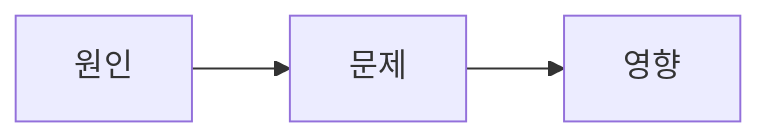
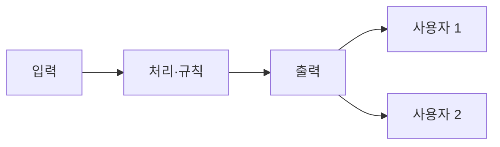

# 문제 지도

_빈 기록 양식 · sk-exam-frame이 작성 · 참가자가 먼저 쓰고 AI는 빈칸만 짚음 · 원인·가정에는 근거 상태(과제 명시 / 데이터 관찰 / 담당자 확인 / 가설 / 미확인), 가정·질문에는 출처(참가자 / AI 제안→참가자 수정 / AI 제안 그대로)를 붙임_

---

## 자료 사실 (AI가 1단계에서 정리 · 해석 없음)

- 과제 원문 위치:
- 데이터 파일·열·행 수:
- 분포 그림(frame_viz.py `scatter`)과 요약: 결측·숫자 아님 _ / 보기 범위 밖 _ / 그룹별 개수 _
- 기존 코드·실행 방법:

## 0. 참가자가 먼저 쓴 것 (원문, 고치지 않음)

1. 풀어야 할 문제:
2. 근본 원인이라고 생각하는 것:
3. 30분 해법과 가장 위험한 가정:
4. 담당자에게 묻고 싶은 질문 3개:

AI가 짚은 빈 범주(3단계):

| 빈 범주 | 근거가 된 자료 사실 | AI 질문 후보 | 참가자 선택(채택/수정/제외)과 이유 |
|---|---|---|---|

## 1. 한 문장 문제

- 누가:
- 어떤 결정·행동을:
- 무엇 때문에 지금 못 하나:
- 결과물이 그 사람에게 바꾸는 것:

## 2. 지금 → 바라는 상태, 근본 원인

| 지금 | 바라는 상태 |
|---|---|
| | |

| 원인 가설 | 근거 상태 | 근거 위치 | 출처 |
|---|---|---|---|



## 3. 시스템 경계



텍스트 도식:

```text
입력 → 처리 → 출력 → 사용자
```

| 사용자 | 하는 행동 | 보는 것 |
|---|---|---|

## 4. 단순 해법과 숨은 가정

- 30분 버전:

| # | 단순 해법이 깔고 있는 가정 | 현실이 다르면 깨지는 결과 | 상태(확인/반박/미확인) | 출처 |
|---|---|---|---|---|

## 5. 인터뷰 질문 (영향 큰 순, 참가자가 직접 한 주제씩)

| # | 질문 | 붙인 자료 사실 | 답에 따라 바뀌는 코드·결과 | 관련 가정 # | 출처 | 받은 답 위치 |
|---|---|---|---|---|---|---|

## 6. 접근 순서

- 첫 end-to-end 범위:
- 답을 받은 뒤 붙일 것:
- 이번 과제에서 하지 않을 것:

## 그림

- 문제 지도: `problem_map.svg` / `.png`
- 데이터 분포: `data_scatter.svg` / `.png`
